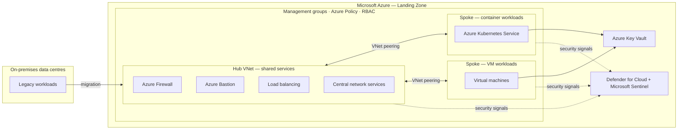
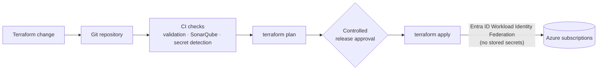

# Azure Cloud Migration & Landing Zone Architecture — AT&T

**Role:** Azure Cloud / Solutions Architect · **Author:** [Ing. Prateek Chauhan](https://prateek-chauhan79.github.io/prateek-chauhan-portfolio/)

> **About this repository.** This is an architecture case study. It describes the design, security controls and delivery approach I used to migrate AT&T on-premises workloads to Microsoft Azure. It contains no proprietary code, configuration or customer data.

---

## Overview

AT&T needed a secure, governed foundation on Microsoft Azure for workloads moving out of on-premises data centres. I designed an **Azure Landing Zone** built on a **hub-and-spoke network topology**. It provides centralised connectivity, security and governance, and keeps each workload isolated.

The platform is provisioned entirely through **Terraform** and delivered by **Azure DevOps CI/CD pipelines**. Those pipelines authenticate to Azure with **passwordless Workload Identity Federation**, so no long-lived secrets are stored anywhere in the delivery chain.

---

## Architecture

### Hub
- **Azure Firewall** inspects and controls traffic centrally.
- **Azure Bastion** provides secure administrative access without exposing public IPs.
- **Load balancing and central network services** are shared by every spoke.

### Spokes
- **Container spoke:** Azure Kubernetes Service (AKS) for containerised applications.
- **VM spoke:** virtual machines for applications that still need traditional infrastructure.
- Each spoke is isolated, and all traffic routes through the hub.

---

## Delivery pipeline

- **Infrastructure as Code:** Terraform provisions and configures every component, so deployments are consistent, repeatable and version-controlled across environments.
- **CI/CD:** Azure DevOps pipelines combine source control, validation, security checks and controlled releases.
- **Shift-left security:** SonarQube code analysis and Git-based secret detection catch code-quality issues and credential exposure before anything is deployed.

---

## Security and governance controls

| Area | Control |
|---|---|
| **Governance** | Azure Policy assigned at management-group and subscription level enforces governance standards, security baselines and compliance controls |
| **Identity** | Entra ID Workload Identity Federation between Azure DevOps and Azure means no long-lived client secrets are needed |
| **Access** | Azure built-in RBAC enforces least-privilege access to resources |
| **Secrets** | Azure Key Vault stores secrets and sensitive configuration securely |
| **Posture and detection** | Microsoft Defender for Cloud handles posture management; Microsoft Sentinel handles threat detection, monitoring and incident investigation |
| **Network** | Traffic from isolated spokes is inspected centrally by Azure Firewall, and admin access goes through Azure Bastion |
| **Secure development** | SonarQube analysis and secret detection run in every pipeline |

---

## Key design decisions

1. **Hub-and-spoke over a flat network.** Firewall, Bastion and shared services are centralised once, and each workload stays isolated in its own spoke.
2. **Policy as the guardrail.** Standards are enforced through Azure Policy at management-group level rather than through manual review, so every new subscription inherits them automatically.
3. **Passwordless delivery.** Workload Identity Federation removes the most common pipeline risk: leaked or expired service-principal secrets.
4. **Everything as code.** Terraform with gated releases makes changes reviewable, auditable and repeatable.
5. **Security built into the delivery lifecycle.** Identity controls, policy enforcement and security validation are part of the pipeline itself, not an afterthought.

---

## Technology

`Microsoft Azure` · `Azure Landing Zone` · `Hub-and-Spoke` · `Azure Firewall` · `Azure Bastion` · `AKS` · `Virtual Machines` · `Azure Policy` · `Management Groups` · `Microsoft Defender for Cloud` · `Microsoft Sentinel` · `Microsoft Entra ID` · `Workload Identity Federation` · `Azure RBAC` · `Azure Key Vault` · `Terraform` · `Azure DevOps` · `SonarQube` · `Secret detection`

---

## Author

**Ing. Prateek Chauhan**, Cloud & AI Architect · Cloud, Identity & AI Security
[Portfolio](https://prateek-chauhan79.github.io/prateek-chauhan-portfolio/) · [LinkedIn](https://www.linkedin.com/in/prateekchauhan) · prateekchauhan2004@gmail.com
